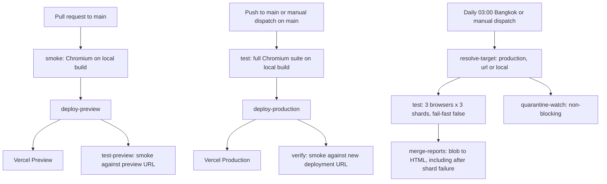
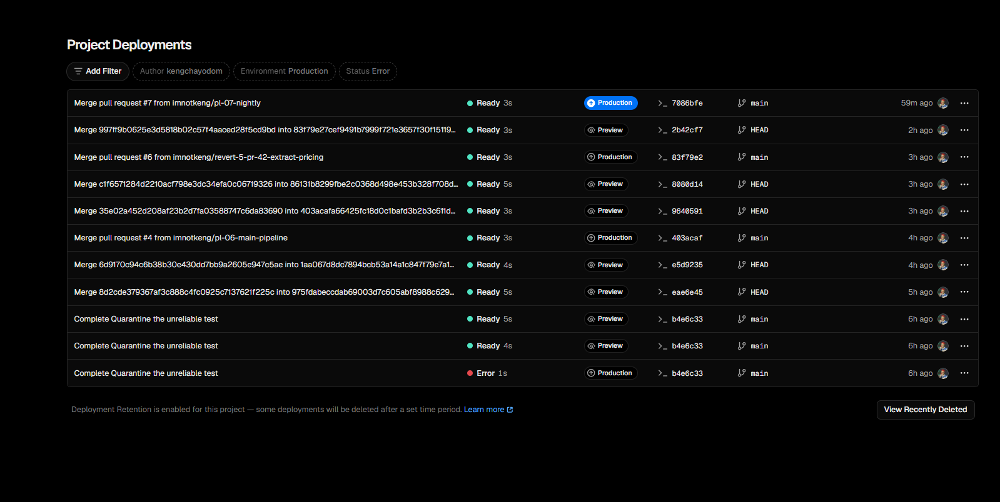
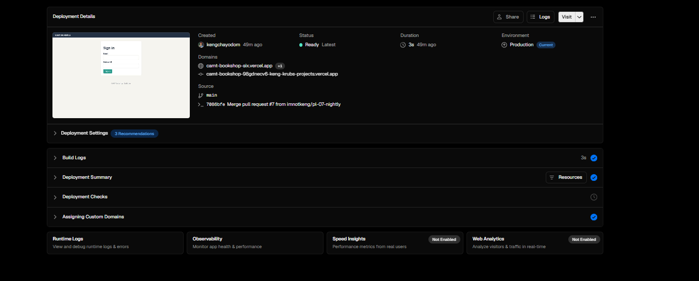
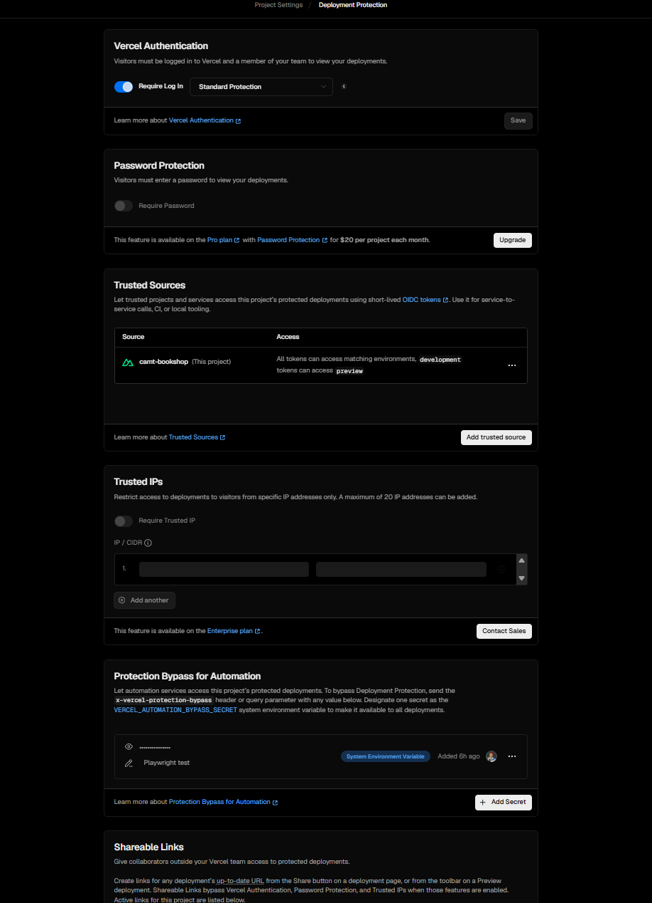
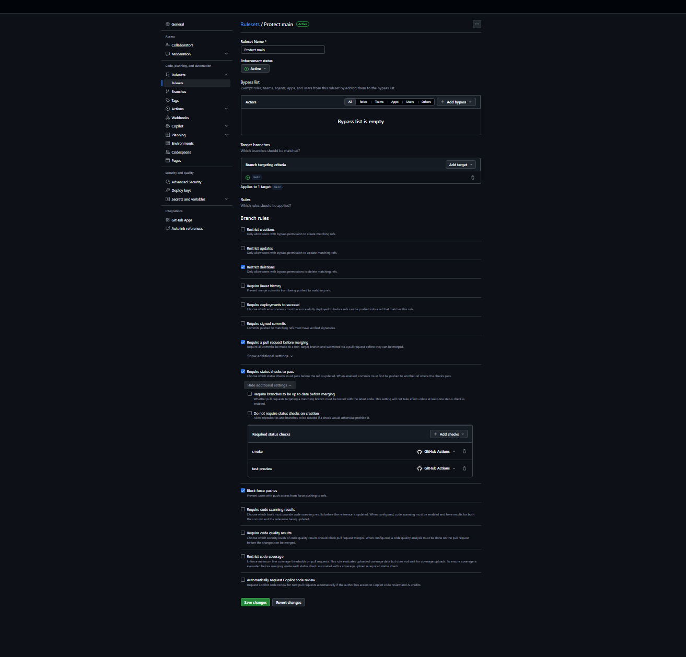
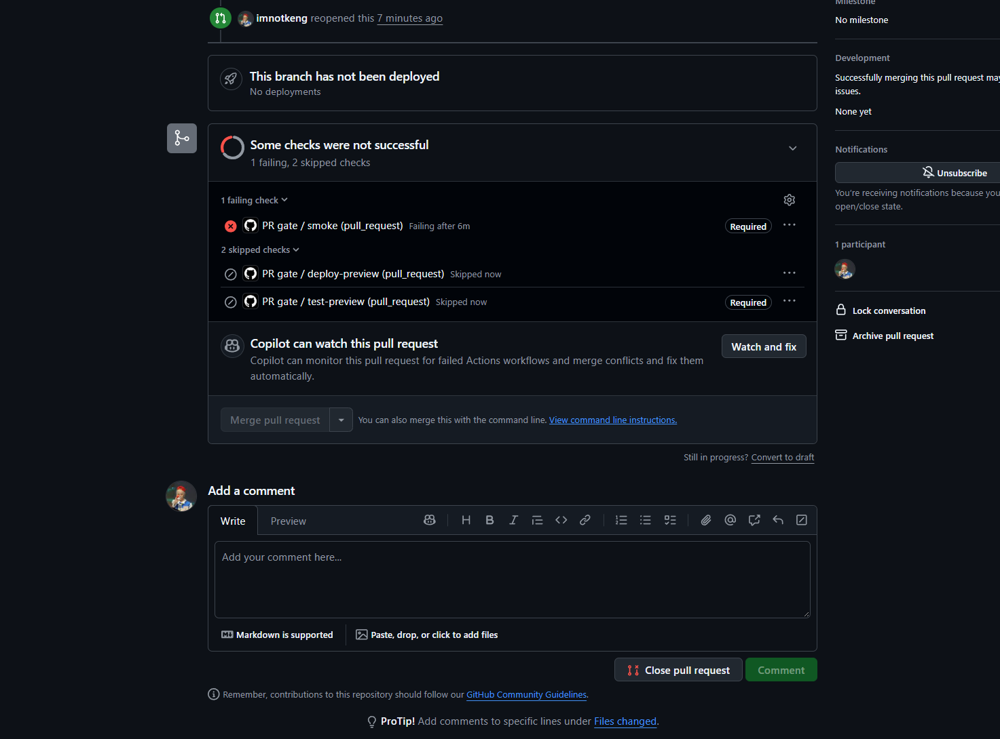
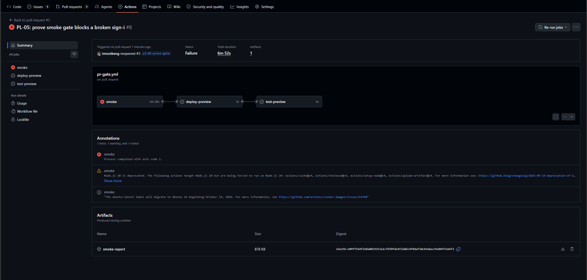
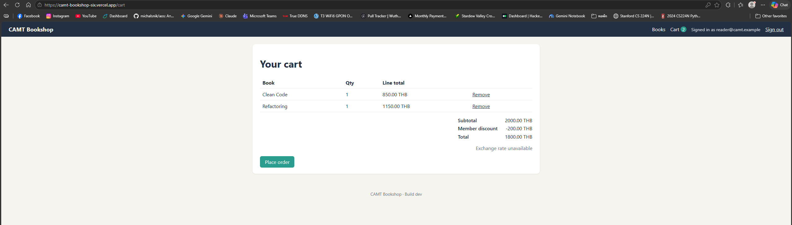

# PIPELINE.md — CAMT Bookshop

Student ID: 662115008  
Name: Chayodom Jaisodsai  
Repository: [imnotkeng/camt-bookshop](https://github.com/imnotkeng/camt-bookshop)

Production URL: [camt-bookshop-six.vercel.app](https://camt-bookshop-six.vercel.app)

## 1. Pipeline at a glance

Blocking jobs exclude `@quarantine`. Main pipeline runs are serialized with `cancel-in-progress: false`.

## 2. Evidence

| AC | What | Link / screenshot |
|---|---|---|
| AC-03.2 | Vercel deployment list | [Deployment list](pictures/vercel-deployment-list.png), [Production details](pictures/vercel-deployment.png), and matching [Main pipeline #4](https://github.com/imnotkeng/camt-bookshop/actions/runs/41236836106), commit `7086bfe`. Git deployments are disabled in `vercel.json`; initial manual setup deployments are separate from Actions deployments. |
| AC-03.4 | Authentication enabled and bypass created | [Deployment Protection](pictures/vercel-settings.png). HTTP check: 302 without bypass, 200 with bypass. |
| AC-04.3–4 | Green PR gate and preview URL | [PR gate #2](https://github.com/imnotkeng/camt-bookshop/actions/runs/41219010992): smoke, deploy-preview and test-preview passed. Preview URL is in the run summary. Additional [PR gate #4 with preview summary](https://github.com/imnotkeng/camt-bookshop/actions/runs/41222393487#summary-124599784065): [Preview](https://camt-bookshop-a63msivmf-keng-krubs-projects.vercel.app). |
| AC-04.6 | Same run's duration with warm cache | [PR gate #2 duration](https://github.com/imnotkeng/camt-bookshop/actions/runs/41219010992/usage): 1m 51s. Smoke browser-cache hit confirmed. |
| AC-05.1–3 | Main branch ruleset | [Ruleset](pictures/ruleset.png): Active, target main, PR required, required checks smoke/test-preview, deletion and force pushes blocked. Required approvals: 0. |
| AC-05.4 | PR blocked by a red required check | [PR #3](https://github.com/imnotkeng/camt-bookshop/pull/3), [blocked Merge button](pictures/pr-3-merge-blocked-2.png), [failed run](https://github.com/imnotkeng/camt-bookshop/actions/runs/41239682713), [run screenshot](pictures/pr-3-merge-blocked.png). |
| AC-06.3–4 | Green Main pipeline | [Main #1](https://github.com/imnotkeng/camt-bookshop/actions/runs/41223517706): test, deploy-production and verify passed in 2m 22s. |
| AC-06.7 | Main test failed and deploy skipped | [Main #2](https://github.com/imnotkeng/camt-bookshop/actions/runs/41228948745): test failed; deploy-production and verify skipped. |
| AC-07.2 | Manual Nightly runs and merged reports | [Production #2, attempt 3](https://github.com/imnotkeng/camt-bookshop/actions/runs/41237476520/attempts/3): artifact `nightly-html-report-production`; [URL #3](https://github.com/imnotkeng/camt-bookshop/actions/runs/41238581371): `nightly-html-report-url`; [Local #4](https://github.com/imnotkeng/camt-bookshop/actions/runs/41238599724): `nightly-html-report-local`. Each merged report contains 45 passed, 0 failed, 0 flaky. |
| AC-08.2 | Quarantine issue | [FX triage issue #1](https://github.com/imnotkeng/camt-bookshop/issues/1) |

## 3. Timings

| Run | Cold cache | Warm cache | Budget | Within? |
|---|---|---|---|---|
| PR gate (all three jobs) | [2m 21s, attempt 3](https://github.com/imnotkeng/camt-bookshop/actions/runs/41234369741/attempts/3) | [1m 51s](https://github.com/imnotkeng/camt-bookshop/actions/runs/41219010992); [2m 34s](https://github.com/imnotkeng/camt-bookshop/actions/runs/41234369741/attempts/2) | 8 min | Yes |
| Main pipeline (all three jobs) | [2m 22s](https://github.com/imnotkeng/camt-bookshop/actions/runs/41223517706), mixed: test miss, verify hit | [2m 9s](https://github.com/imnotkeng/camt-bookshop/actions/runs/41229555458), test and verify hits | 10 min | Yes |
| Nightly, target = production (start to merged report) | [1m 55s, attempt 4](https://github.com/imnotkeng/camt-bookshop/actions/runs/41237476520/attempts/4), sampled Chromium cache miss | [2m 10s, attempt 3](https://github.com/imnotkeng/camt-bookshop/actions/runs/41237476520/attempts/3), sampled Chromium cache hit | 20 min | Yes |
| Nightly, target = local (start to merged report) | [2m 0s, attempt 2](https://github.com/imnotkeng/camt-bookshop/actions/runs/41238599724/attempts/2), sampled Chromium cache miss | [2m 26s, attempt 1](https://github.com/imnotkeng/camt-bookshop/actions/runs/41238599724/attempts/1), sampled Chromium cache hit | 20 min | Yes |

Cache classifications refer to the browser-cache steps checked. Nightly figures are whole-workflow durations, including report merging and the parallel quarantine job.

**Which step did the browser cache save the most time on, and how much?** The measured comparison is `Install Chromium and system dependencies` in PR gate smoke: cache miss 16s versus cache hit 9s, a 7s reduction (43.75%), excluding cache restoration. Other steps were not compared, so the largest overall saving is not established.

**Nightly production versus local — which was faster, and why?** Production was 5s faster in the cache-miss runs (1m 55s versus 2m 0s), and 16s faster in the cache-hit runs (2m 10s versus 2m 26s). Local additionally builds and starts the application on each runner. The cache-miss runs were faster overall than the earlier cache-hit runs, so whole-run differences cannot be attributed to cache alone; runner, test and quarantine durations also vary.

## 4. Triage record — the quarantined test

| Field | Record |
|---|---|
| Symptom | FX conversion intermittently fails when the exchange-rate endpoint returns HTTP 503. |
| Local measurement (`--repeat-each=10`) | 5 passed / 5 failed |
| Classification (regression / flaky / environment) | Environment |
| Evidence that decided it | Failed trace: `GET /api/rates` returned `503 Service Unavailable`. |
| Containment applied | `@quarantine`, issue/expiry annotations, excluded from blocking jobs; Nightly quarantine-watch runs against the selected target with `continue-on-error: true`. |
| Cure (planned or done) | Planned: use `page.route()` to test a successful rate response and HTTP 503 deterministically. |
| Expiry date | 2026-11-01 |

## 5. The teammate's pull request (PR-42)

The supplied patch was submitted as [PR #5](https://github.com/imnotkeng/camt-bookshop/pull/5).

1. **PR gate:** [all three jobs passed](https://github.com/imnotkeng/camt-bookshop/actions/runs/41228695500) in 2m 13s. Neither smoke run covered the exact-2,000-THB discount boundary.
2. **Main pipeline:** [test failed](https://github.com/imnotkeng/camt-bookshop/actions/runs/41228948745) with 13 passed and 2 failed: `member discount applies at exactly 2,000 THB` and `the discounted total is what the reader pays`. Checkout expected 1800.00 THB but received 2000.00 THB. Deploy and verify were skipped; total 1m 11s.
3. **While main was red:** Vercel's latest Ready Production deployment remained commit `403acaf` from PR #4; no Production deployment was created for merge commit `86131b8`. Production cart behaviour was not recorded during that interval. [Later production check after revert](pictures/production-cart-after-revert.png) shows subtotal 2000.00 THB, discount -200.00 THB and total 1800.00 THB.
4. **Restoration:** merged [Revert PR #6](https://github.com/imnotkeng/camt-bookshop/pull/6). [Main #3](https://github.com/imnotkeng/camt-bookshop/actions/runs/41229555458), commit `83f79e2`, passed all three jobs in 2m 9s and deployed Production.
5. **Think first #10 decision:** tag the boundary test `@smoke` to protect a critical pricing rule in both local and preview gates with one targeted addition.

## 6. Think-first answers

### 1. FX failure classification

Predicted: **7 passes**. Actual: **5 passed / 5 failed**. Classification: **environment**. The decisive evidence was `GET /api/rates` returning HTTP 503 in a failed trace. The observed number of passes differed from my prediction.

### 2. Missing .gitignore entries

- `.vercel/`: project/account linkage and downloaded environment files could be committed.
- `blob-report/`: generated Playwright reports and attachments could be committed.
- `.env`: local credentials and other secrets could be published.

### 3. Removing retry: 0

A failed GET is retried once by default, including HTTP 503 ([ofetch documentation](https://github.com/unjs/ofetch#auto-retry)). Assuming independent requests, the failure rate becomes **0.35² = 12.25%**. An application retry can hide the first request failure behind a passing test; Playwright retries preserve the failed test attempt and classify a pass on retry as flaky.

### 4. Removing a committed password

The password remains exposed in Git history and potentially in clones or caches. Rotate/revoke it at its source first, then coordinate history cleanup where appropriate. Deleting the line alone does not make the password safe.

### 5. Retry probabilities

Assuming independent attempts:

- `retries: 2`: three attempts, **0.35³ = 4.2875%** probability all fail.
- `retries: 5`: six attempts, **0.35⁶ = 0.1838265625%** probability all fail.

More retries hide the external failure without curing it and increase runtime. Quarantine keeps it visible outside the gate; AC-08.5 also prohibits raising retries above 2 to make it pass.

### 6. Independent Vercel Git deployments

Vercel could deploy the buggy main commit independently of a failed Actions test job. Customers could receive the faulty build if that deployment succeeds. Disabling Git deployments keeps production deployment dependent on the pipeline's test result.

### 7. Protected previews

**Private window:** Vercel login page, because Authentication is enabled and the browser has no Vercel session.

**Tests without bypass:** application tests fail because requests cannot reach the app.

**Fixes:** (a) disable Authentication; (b) keep it enabled and send the automation bypass secret. **Chosen: (b)** under PL-03, preserving preview privacy while admitting automated tests. HTTP checks returned 302 without bypass and 200 with bypass.

### 8. Required checks

GitHub needs previously reported check names to offer them as required checks. Invalid YAML that prevents those checks from starting can show a workflow error while required checks remain expected/waiting, blocking merge ([GitHub documentation](https://docs.github.com/en/pull-requests/how-tos/merge-and-close-pull-requests/troubleshooting-required-status-checks)).

### 9. PR-42 prediction and result

**Prediction:** (a) PR gate passes; (b) Main fails; (c) `member discount applies at exactly 2,000 THB` catches the change from `>=` to `>`. At exactly 2,000 THB, the patch incorrectly removes the 200 THB discount. Somchai ran only smoke tests, which excluded this boundary.

**Actual result:** PR gate passed. Main failed the predicted cart test and also `the discounted total is what the reader pays`; the regression affected two tests rather than only the cart test named in the prediction.

### 10. Catching the bug before merge

**Tag the boundary test @smoke:** for — catches a critical pricing regression on both local and preview builds with one additional test; against — does not cover all other regressions and adds to smoke runtime.

**Full suite on preview:** for — broader deployed-environment coverage, including cart and checkout; against — more tests and retries consume the eight-minute PR budget.

**Decision:** add the boundary test to `@smoke`. It targets an important rule while keeping the gate small. Measure the gate after implementation to confirm it stays within eight minutes. This is the selected improvement, not an implemented tag change.

## 7. One thing I would change

I would replace the quarantined FX test with two deterministic tests using `page.route()`: one returns a successful exchange rate, and the other returns HTTP 503. This would verify both application behaviours without depending on the randomly failing service. I would measure the improvement by repeating both tests on all three browsers and comparing their failure rate and runtime with the original test.
